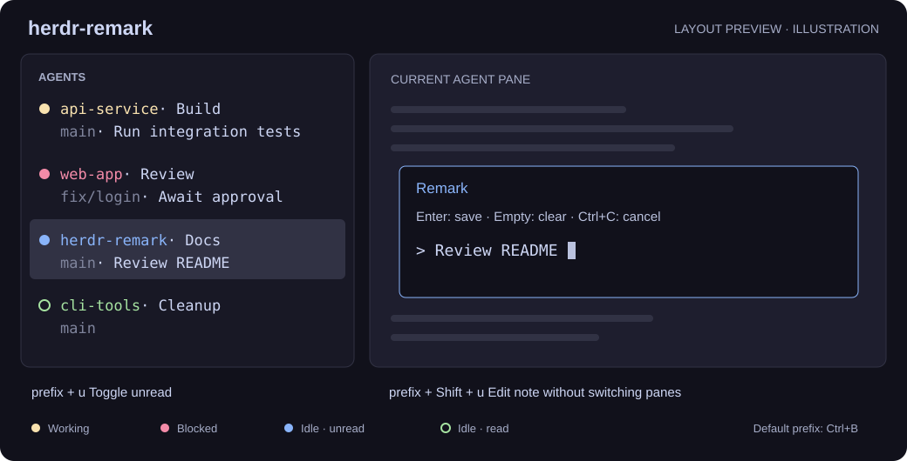

# herdr-remark

[English](README.md) | **简体中文**

用两个快捷键，为 Herdr Agent 标记已读／未读、编辑简短备注，无需离开当前 pane。无 npm 依赖，无构建步骤。



*上图为布局示意，非实际截图。* 第一行：状态灯 + 目录名 · Tab 名；第二行：Git 分支 · 备注，空项自动隐藏。灯与目录同色，其他字段独立着色。

## 安装

需要 **Herdr 0.8.2+、Node.js 18+ 和 Git**，均需位于 `PATH`。推荐使用包含聚焦事件修复的 Herdr 0.9.1+。在已启动的 Herdr 会话内执行：

```sh
git clone https://github.com/huluhuluu/herdr-remark.git
cd herdr-remark
```

**Windows · PowerShell**

```powershell
powershell -NoProfile -ExecutionPolicy Bypass -File .\scripts\install.ps1
```

**Linux · Bash**

```bash
bash scripts/install.sh
```

脚本备份并校验配置、链接插件、配置侧边栏和快捷键。**安装后请保留仓库目录。** 命令末尾加 `--check` 可仅校验。如果已有侧边栏或快捷键配置冲突，请手工合并 [config.example.toml](config.example.toml)，再运行 `herdr plugin link .` 和下方重载命令。

## 使用

先聚焦目标 Agent。默认 `prefix` 为 `Ctrl+B`：先按下并松开，再按后一个键。

| 快捷键 | 操作 |
| --- | --- |
| `prefix+u` | 切换已读／未读 |
| `prefix+shift+u` | 在小浮层中编辑备注 |

**未读：** 标记后仅停留在当前 Agent 不会清除；终端回滚位置实际变化、离开再返回、再次按快捷键、保存备注，或给所在 Tab 改名均可清除。Tab 改名将该 Tab 下所有 Agent 标为已读。新输出引起的滚动位置增长和窗口缩放不会算作查看。已查看的完成回合显示绿色 `○`，下一次完成仍会显示蓝色 `●`。工作和阻塞状态优先于未读显示。

**完成回合：** 每个观察到的完成回合都先显示蓝色，包括当前 Tab。接口提供 `completion_seq` 时，使用它区分完成回合与原生已查看状态；旧版通过已观察到的工作／阻塞 → 空闲转换识别。插件未运行期间遗漏的完成，不能仅凭空闲快照补回。标为已读不再调用原生 `agent focus`，不改变其他 Agent 的执行状态。

**滚动范围：** 各平台仍通过 Herdr 公开事件识别终端回滚。Windows Terminal 另接入实验性的只读滚轮监听，用于终端偏移保持为 0 的全屏应用。它从实时会话快照取得实际聚焦 pane，通过 Windows UI Automation 核对可见内容和字符尺寸，仅确认匹配 pane 内容区内的滚轮操作。不拦截或改写输入，不修改 Herdr，也不依赖特定 Agent 的 hook。

监听仅在存在未读 pane 时启动，随原有监控退出。可见文本只经本地管道在内存中比对，不保存、不记录日志。后台／锁屏窗口、内容匹配失败或文字不足时保留未读；滚到边界后继续使用滚轮仍算查看。内容匹配不是 Herdr 原生客户端身份标识，不同会话显示完全相同内容时，无法可靠区分。**macOS、Linux 和其他 Windows 终端目前仍仅识别公开终端回滚事件。** Windows 已验证输入采集、内容区定位及辅助进程生命周期，真实滚轮到绿灯的完整操作验证仍待进行。

**事件边界：** Herdr 的聚焦／改名事件没有原始序号，也不区分用户或插件来源。目标已不再聚焦、或 Tab 名称已被后续改名替换的旧事件只刷新信息；仍符合当前状态的迟到事件，暂时无法完全区分。自动改名插件触发的 Tab 改名与手动改名一样会清除未读。

| 状态 | 灯 |
| --- | --- |
| 工作中 | 黄色 `●`，慢闪烁 |
| 阻塞／等待输入 | 红色 `●` |
| 空闲、已读 | 绿色 `○` |
| 未读（手动标记，或已完成的回合） | 蓝色 `●` |
| 未知 | 灰色 `·` |

```text
阅读状态（不改变 Agent 的执行状态）
  空闲已读 ──手动标记未读──→ 未读
  新的完成回合（idle/done）→ 未读
  未读 ──确认已读─────────→ 已读
          ├─ 未读快捷键
          ├─ 离开后重新聚焦
          ├─ 终端回滚位置实际变化
          ├─ Windows Terminal 内容区滚轮（匹配成功）
          ├─ 保存／清空备注：当前 Agent
          └─ Tab 改名：该 Tab 下全部 Agent

最终灯色
  working → 黄灯闪烁；blocked → 红灯；unknown → 灰点
  idle / done → 未读为蓝色 ●，已读为绿色 ○
```

已读不会将工作中或阻塞状态改为绿色。单纯刷新目录／分支以及新输出不会清除手动未读；备注保存失败也不会新增已读写入。

**工作闪烁：** Agent 工作中时黄灯与目录文字一起缓慢闪烁，默认开启。插件通过 API socket 交替显示亮色与暗色 token。闪烁与滚动已读共用一个后台进程；没有需要闪烁的工作灯或未读 pane 时自动退出。关闭闪烁仍保留常亮黄灯和滚动已读。

如需关闭或调整频率，在本插件的配置目录（`herdr plugin list` 会打印路径，通常为 `%APPDATA%\herdr\plugins\config\huluhlu.agent-inform`）新建 `config.json`：

```json
{ "blink": false, "blink_interval_ms": 400, "wheel_read": true }
```

所有键均可选。`wheel_read` 默认开启；设为 false 只关闭 Windows 滚轮监听，保留公开终端回滚识别。`blink_interval_ms` 会被限制在 100–60000 之间，默认 800。监控运行时，修改会在下一轮生效；监控已退出或原生辅助进程失败时执行 `npm run init`。闪烁依赖侧栏 rows 中的暗色 `$remark_lamp_working_blink` token，缺失时请重新执行安装脚本。

**备注：** 依次使用已有 pane 名称 → Agent 摘要 → 会话标题作为初始内容。`Enter` 保存，清空后按 `Enter` 删除，`Ctrl+C` 取消。最多 80 个 Unicode 字符，保存为原生 pane 名称，会替换已有自定义名称。

## 修改快捷键

编辑 Herdr **实际使用的 `config.toml`**，Windows 通常为 `%APPDATA%\herdr\config.toml`，Linux 为 `~/.config/herdr/config.toml`。路径优先使用 `HERDR_CONFIG_PATH`，其次为 `XDG_CONFIG_HOME/herdr/config.toml`。

找到下列两个已有绑定（脚本安装时位于 `# herdr-remark begin` / `end` 内），仅修改 `key`。例如将 `u` 改为 `r`：**替换原条目，不要重复追加**，并选用未被占用的按键。

```toml
[[keys.command]]
key = "prefix+r"
type = "plugin_action"
command = "huluhlu.agent-inform.toggle-unread"

[[keys.command]]
key = "prefix+shift+r"
type = "plugin_action"
command = "huluhlu.agent-inform.note"
```

校验并应用修改：

```sh
herdr config check
herdr server reload-config
```

手工安装或更新代码后，在仓库目录运行 `herdr plugin link .`，再运行 `npm run init`。后者调用 Herdr 的 `refresh` 插件动作，使用实际插件目录、等待初始化结果，并通知已有监控在下一轮释放锁、用新代码重启。更新代码使用 `git pull --ff-only`；重新执行安装脚本会将管理区块内的快捷键和颜色恢复为示例默认值。

## 说明

- 正常刷新只写入 Remark 元数据，不清除 Agent authority。可选 Windows 滚轮监听会枚举 Windows Terminal 进程以筛选鼠标输入。
- Herdr 服务器重启后未读标记重置，备注由 Herdr 持久保存。
- 状态灯使用静态 Catppuccin 配色，不自动跟随主题；可修改侧边栏配置中的 `fg`。
- 每次状态刷新都重新核对目录、Tab 名和 Git 分支；Tab 改名会刷新该 Tab 下的所有 Agent。闪烁间隔只更新灯，滚动事件通过 socket 订阅，不提供原生侧边栏右键菜单。
- Herdr 未提供 pane 重命名事件，因此在快捷键之外改名（其他工具或第二个客户端）后，侧边栏会保留旧备注，直到下一次聚焦或 Agent 事件。
- 已在 Windows 验证；Bash 安装脚本已通过 Git Bash 检查，尚未在原生 Linux 验证。

**只读滚轮探针（仅 Windows Terminal）：** 执行 `powershell -NoProfile -ExecutionPolicy Bypass -File scripts/probe-scroll.ps1 -Seconds 30`，复用正式辅助进程，输出前台 Windows Terminal 窗口中的滚轮坐标，连续事件会合并。探针模式不读取对话文本、不改变输入或已读状态、不写日志，退出时卸载监听，最长运行 60 秒。探针本身不验证 pane 匹配。

开发测试：`npm test`；修改 manifest 后重新运行 `herdr plugin link .`。

[更新记录](CHANGELOG.md) · [问题反馈](https://github.com/huluhuluu/herdr-remark/issues) · [MIT 许可证](LICENSE)
